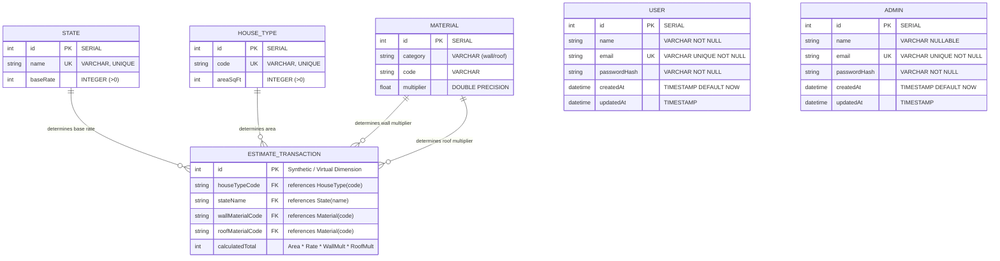

# Q2: Schema & Data Model Walkthrough

## 1. Entity-Relationship (ER) Architecture

The **Virtual House Visualizer and Cost Estimator** database is built upon a star/snowflake-adjacent relational schema where central estimation events join multiple dimension master tables.



---

## 2. Table Specifications, Keys & Relationships

### A. Master Entities & Keys

#### 1. `State` (Table Name: `"State"`)
- **Primary Key:** `id` (`INTEGER`, `SERIAL`, auto-incrementing surrogate key).
- **Alternate / Candidate Key:** `name` (`TEXT`, `UNIQUE`). Every state in India has a unique name (e.g., 'Chhattisgarh', 'Odisha', 'Madhya Pradesh').
- **Attributes:**
  - `baseRate`: `INTEGER NOT NULL`. Represents the base construction cost per square foot in Indian Rupees (INR).

#### 2. `HouseType` (Table Name: `"HouseType"`)
- **Primary Key:** `id` (`INTEGER`, `SERIAL`, auto-incrementing).
- **Alternate / Candidate Key:** `code` (`TEXT`, `UNIQUE`). Fixed standardized codes (`1BHK`, `2BHK`).
- **Attributes:**
  - `areaSqFt`: `INTEGER NOT NULL`. Carpet and plinth construction area in square feet (e.g., $270\text{ sq.ft}$ for 1BHK, $450\text{ sq.ft}$ for 2BHK).

#### 3. `Material` (Table Name: `"Material"`)
- **Primary Key:** `id` (`INTEGER`, `SERIAL`).
- **Composite Candidate Key:** `(category, code)` (`@@unique([category, code])`).
  - `category`: `TEXT NOT NULL` (e.g., `'wall'`, `'roof'`).
  - `code`: `TEXT NOT NULL` (e.g., `'brick'`, `'flyash'`, `'block'`, `'rcc'`, `'tin'`).
- **Attributes:**
  - `multiplier`: `DOUBLE PRECISION NOT NULL`. A calibrated floating-point coefficient relative to baseline standard specifications ($1.00$).

#### 4. `User` (Table Name: `"User"`)
- **Primary Key:** `id` (`INTEGER`, `SERIAL`).
- **Alternate Candidate Key:** `email` (`TEXT`, `UNIQUE NOT NULL`).
- **Attributes:**
  - `name`: `TEXT NOT NULL`.
  - `passwordHash`: `TEXT NOT NULL` (Bcrypt 12-round hash).
  - `createdAt` / `updatedAt`: `TIMESTAMP(3)` audit tracking.

#### 5. `Admin` (Table Name: `"Admin"`)
- **Primary Key:** `id` (`INTEGER`, `SERIAL`).
- **Alternate Candidate Key:** `email` (`TEXT`, `UNIQUE NOT NULL`).
- **Attributes:**
  - `name`: `TEXT NULLABLE`.
  - `passwordHash`: `TEXT NOT NULL`.
  - `createdAt` / `updatedAt`: `TIMESTAMP(3)`.

---

## 3. Explaining Relationships & Resolving Many-to-Many (M:N)

### Cardinality Breakdown
- **State to Estimates:** **$1:N$** (One state governs thousands of house cost estimates).
- **HouseType to Estimates:** **$1:N$** (One house layout design applies to multiple beneficiary estimates).
- **Material to Estimates:** **$1:N$** (A specific material, like 'flyash', is referenced across multiple house configurations).

### How M:N Relationships are Resolved
In a building visualizer, a **House Type** and a **Material** have an inherent **Many-to-Many (M:N)** conceptual relationship:
- A single house type (e.g., `1BHK`) can be built using multiple wall and roof materials (Brick + RCC, Flyash + Tin, Block + RCC, etc.).
- A single material (e.g., `Flyash`) can be utilized across all house types (`1BHK`, `2BHK`, and future expansion types).

**Resolution Mechanism:**
Rather than hardcoding material arrays inside the `HouseType` table or creating an unmanageable matrix table:
1. In the relational database, each dimension entity (`HouseType`, `Material`, `State`) is stored as an independent, fully normalized relation.
2. The **Estimation Calculation Engine** (`POST /api/estimate`) acts as the dynamic transaction junction that resolves the M:N Cartesian product on demand.
3. For persistent logging or saved quote scenarios, the M:N relationship resolves into an explicit **Junction / Transaction Table** (`EstimateLog`), where foreign keys point back to each dimension:
   $$\text{EstimateLog}(\text{id}, \text{houseTypeId}^{\text{FK}}, \text{stateId}^{\text{FK}}, \text{wallMaterialId}^{\text{FK}}, \text{roofMaterialId}^{\text{FK}}, \text{totalCost}, \text{createdAt})$$

---

## 4. Demonstrating the Schema in Migration Files & Database Tools

### Prisma Schema Definition (`backend/prisma/schema.prisma`)
```prisma
datasource db {
  provider = "postgresql"
}

model State {
  id       Int    @id @default(autoincrement())
  name     String @unique
  baseRate Int
}

model HouseType {
  id       Int    @id @default(autoincrement())
  code     String @unique
  areaSqFt Int
}

model Material {
  id         Int    @id @default(autoincrement())
  category   String
  code       String
  multiplier Float

  @@unique([category, code])
}

model Admin {
  id           Int      @id @default(autoincrement())
  name         String?
  email        String   @unique
  passwordHash String
  createdAt    DateTime @default(now())
  updatedAt    DateTime @updatedAt
}

model User {
  id           Int      @id @default(autoincrement())
  name         String
  email        String   @unique
  passwordHash String
  createdAt    DateTime @default(now())
  updatedAt    DateTime @updatedAt
}
```

### PostgreSQL DDL from Migration (`backend/prisma/migrations/20261113101845_init/migration.sql`)
```sql
CREATE TABLE "State" (
    "id" SERIAL NOT NULL,
    "name" TEXT NOT NULL,
    "baseRate" INTEGER NOT NULL,
    CONSTRAINT "State_pkey" PRIMARY KEY ("id")
);

CREATE TABLE "HouseType" (
    "id" SERIAL NOT NULL,
    "code" TEXT NOT NULL,
    "areaSqFt" INTEGER NOT NULL,
    CONSTRAINT "HouseType_pkey" PRIMARY KEY ("id")
);

CREATE TABLE "Material" (
    "id" SERIAL NOT NULL,
    "category" TEXT NOT NULL,
    "code" TEXT NOT NULL,
    "multiplier" DOUBLE PRECISION NOT NULL,
    CONSTRAINT "Material_pkey" PRIMARY KEY ("id")
);

CREATE UNIQUE INDEX "State_name_key" ON "State"("name");
CREATE UNIQUE INDEX "HouseType_code_key" ON "HouseType"("code");
CREATE UNIQUE INDEX "Material_category_code_key" ON "Material"("category", "code");
```

---

## 5. Main Cross-Table Join Query

To demonstrate reading across the entire relationship graph in a single query, here is the relational SQL query that joins `HouseType`, `State`, and the `Material` table twice (once aliased for wall and once aliased for roof):

```sql
SELECT 
    h.code AS house_model,
    h."areaSqFt" AS plinth_area,
    s.name AS state_jurisdiction,
    s."baseRate" AS baseline_sqft_rate,
    m_wall.code AS selected_wall,
    m_wall.multiplier AS wall_coeff,
    m_roof.code AS selected_roof,
    m_roof.multiplier AS roof_coeff,
    ROUND(h."areaSqFt" * s."baseRate" * m_wall.multiplier * m_roof.multiplier) AS total_estimate_inr,
    ROUND((h."areaSqFt" * s."baseRate" * m_wall.multiplier * m_roof.multiplier) * 0.20) AS stage_foundation_20pct,
    ROUND((h."areaSqFt" * s."baseRate" * m_wall.multiplier * m_roof.multiplier) * 0.35) AS stage_walls_35pct,
    ROUND((h."areaSqFt" * s."baseRate" * m_wall.multiplier * m_roof.multiplier) * 0.25) AS stage_roof_25pct,
    ROUND((h."areaSqFt" * s."baseRate" * m_wall.multiplier * m_roof.multiplier) * 0.20) AS stage_finishing_20pct
FROM "HouseType" h
CROSS JOIN "State" s
JOIN "Material" m_wall 
    ON m_wall.category = 'wall' AND m_wall.code = 'brick'
JOIN "Material" m_roof 
    ON m_roof.category = 'roof' AND m_roof.code = 'rcc'
WHERE h.code = '2BHK' 
  AND s.name = 'Madhya Pradesh';
```

### Query Execution Output Sample
```text
 house_model | plinth_area | state_jurisdiction | baseline_sqft_rate | selected_wall | wall_coeff | selected_roof | roof_coeff | total_estimate_inr | stage_foundation_20pct | stage_walls_35pct | stage_roof_25pct | stage_finishing_20pct 
-------------+-------------+--------------------+--------------------+---------------+------------+---------------+------------+--------------------+------------------------+-------------------+------------------+-----------------------
 2BHK        |         450 | Madhya Pradesh     |               1150 | brick         |          1 | rcc           |          1 |             517500 |                 103500 |            181125 |           129375 |                103500
```
This single relational read demonstrates the complete data dependency chain powering both the 3D visualization in Unity and the financial charts in React.
