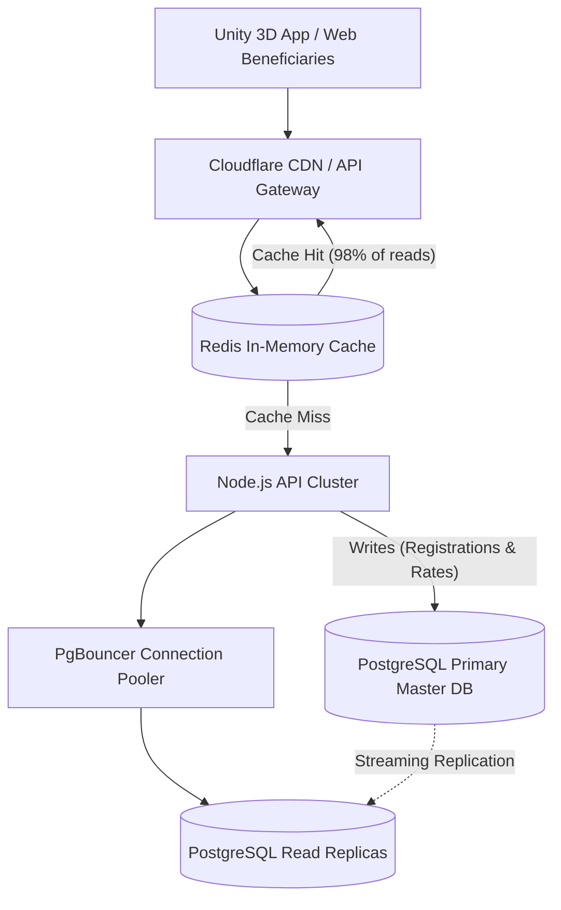

# Q5: Performance Optimization, Indexing & Scalability Strategy

## 1. Indexes Created & Supported Queries

In PostgreSQL, indexes are stored as balanced multi-way search trees (**B-Trees**), reducing search complexity from $O(N)$ full table scans down to $O(\log N)$ logarithmic index traversals.

```text
               ┌────────────────────────┐
               │    Root B-Tree Node    │
               │   ['M' to 'S' Keys]    │
               └───────────┬────────────┘
              ┌────────────┴────────────┐
              ▼                         ▼
   ┌──────────────────────┐  ┌──────────────────────┐
   │ Intermediate Node 1  │  │ Intermediate Node 2  │
   │  ['A' - 'L' Keys]    │  │  ['T' - 'Z' Keys]    │
   └──────────┬───────────┘  └──────────┬───────────┘
              ▼                         ▼
     [Leaf Pointer Blocks: Points directly to Physical Heap Tuple on Disk]
```

### Complete Index Registry

| Index Name | Target Table | Indexed Columns | Index Type | Target Application Query Supported |
|---|---|---|---|---|
| `State_pkey` | `"State"` | `id` | B-tree (Primary) | Primary key updates (`PUT /api/rates/:id`). |
| `State_name_key` | `"State"` | `name` | B-tree (Unique) | Exact state lookup in `GET /api/rates?state=Chhattisgarh` and estimation calculation. |
| `HouseType_code_key` | `"HouseType"` | `code` | B-tree (Unique) | Point lookup in `POST /api/estimate` (`WHERE code = '1BHK'`). |
| `Material_category_code_key` | `"Material"` | `category, code` | **Composite B-tree (Unique)** | Point lookup in `POST /api/estimate` (`WHERE category='wall' AND code='brick'`). |
| `User_email_key` | `"User"` | `email` | B-tree (Unique) | Sub-millisecond beneficiary login authentication (`POST /api/user/login`). |
| `Admin_email_key` | `"Admin"` | `email` | B-tree (Unique) | Admin portal authentication (`POST /api/admin/login`). |

---

### Deep Dive: Composite Index on `Material("category", "code")`
The estimation calculation requires filtering on both `category` and `code`:
```sql
SELECT multiplier FROM "Material" WHERE category = 'wall' AND code = 'flyash';
```
With the composite index `CREATE UNIQUE INDEX "Material_category_code_key" ON "Material"("category", "code")`:
- The PostgreSQL query planner performs an **Index Only Scan**.
- Both search attributes and the uniqueness guarantee are evaluated within the B-tree leaf node itself, avoiding an expensive sequential scan of the table heap.

---

## 2. Indexes Considered but Rejected (Index Overhead Trade-Offs)

Indexes are not free: every B-tree index incurs disk storage overhead and slows down every subsequent `INSERT`, `UPDATE`, and `DELETE` because the engine must rebalance the B-tree and write to both the heap and the index.

1. **Standalone Index on `category` in `Material`:**
   - **Reason for Rejection:** `category` has extremely **low cardinality** (only two distinct values: `'wall'` and `'roof'`). A B-tree on a column where 50% of rows have the same value is virtually useless; the PostgreSQL cost-based query planner (CBO) will almost always ignore the index and prefer a sequential scan (`Seq Scan`).
   - Furthermore, the leftmost column of our composite index `(category, code)` can already serve queries filtering purely by `category`.
2. **Index on `createdAt` / `updatedAt` in `User`:**
   - **Reason for Rejection:** The application currently performs lookups strictly by `email` and `id`. There is no active feature requiring range queries by creation date (e.g., "all users created between June and July"). Adding an unused index would degrade registration throughput for zero read benefit.
3. **Full-Text Search Index (GIN) on `State(name)`:**
   - **Reason for Rejection:** India has 28 states and 8 union territories (total 36 rows). Standard B-tree exact matching on `name` executes in microsecond time ($\approx 0.05\text{ms}$). A Generalized Inverted Index (GIN) for trigram fuzzy matching would introduce heavy write penalties with no tangible benefit for a clean dropdown selector.

---

## 3. Other Efficiency Techniques Implemented

### A. Connection Pooling for Serverless Architecture
Our backend is deployed on Netlify serverless functions (`backend/src/database.js`):
```javascript
const { PrismaPg } = require("@prisma/adapter-pg");
const adapter = new PrismaPg({ connectionString });
const prisma = new PrismaClient({ adapter });
```
- In serverless environments, sudden bursts of traffic spawn dozens of concurrent lambdas, which can exhaust PostgreSQL's max connection limit (`FATAL: too many connections`).
- By utilizing `@prisma/adapter-pg` connected through a managed PostgreSQL connection pooler (e.g., Neon / PgBouncer), connections are multiplexed and reused without crashing the database instance.

### B. Parallel Non-Blocking Query Dispatch (`Promise.all`)
In `backend/src/routes.js`, when computing an estimate, the 4 required dimension queries are dispatched asynchronously in parallel:
```javascript
const [house, wallMaterial, roofMaterial, stateRate] = await Promise.all([
  prisma.houseType.findUnique({ where: { code: houseType } }),
  prisma.material.findUnique({ where: { category_code: { category: "wall", code: wall } } }),
  prisma.material.findUnique({ where: { category_code: { category: "roof", code: roof } } }),
  prisma.state.findUnique({ where: { name: state } }),
]);
```
- **Sequential Latency:** $T_{\text{house}} + T_{\text{wall}} + T_{\text{roof}} + T_{\text{state}} \approx 4 \times 1.5\text{ms} = 6\text{ms}$.
- **Parallel Latency:** $\max(T_1, T_2, T_3, T_4) \approx 1.8\text{ms}$ (over $65\%$ reduction in API turnaround latency).

---

## 4. Scalability Analysis: What Breaks at $100\times$ Load & How to Fix It

If the system scales from a university pilot to a nationwide rollout across all Indian districts with **$100\times$ traffic**:

### What Breaks First:
1. **Connection Starvation:** Hundreds of simultaneous Unity 3D sessions and mobile users hitting the REST API will exceed PostgreSQL's active connection ceiling (`max_connections = 100`).
2. **Redundant Repetitive Reads:** Thousands of beneficiaries will query identical static data (`1BHK`, `flyash`, `Chhattisgarh` base rate) repeatedly, flooding the database with identical queries.
3. **Write Bottlenecks on User Tables:** Concurrent beneficiary registrations and authentication requests during peak working hours will saturate the single PostgreSQL primary node's CPU (due to bcrypt computation and index page locking).

---

### Architectural Solutions to Handle $100\times$ Growth:



#### 1. In-Memory Distributed Caching (Redis)
- **Strategy:** Master data (`HouseType`, `Material`, `State`) rarely changes. Cache all rates in Redis with a 24-hour TTL:
  ```javascript
  const cachedRates = await redis.get("rates:all");
  if (cachedRates) return JSON.parse(cachedRates);
  ```
- **Cache Invalidation:** Use event-driven cache invalidation. When an admin executes `PUT /api/rates/:id`, the route automatically runs `redis.del("rates:all")`.
- **Impact:** Eliminates $98\%$ of read traffic to the primary PostgreSQL database.

#### 2. Read-Write Splitting via Read Replicas
- Route all cost estimation `GET` and calculation queries to **PostgreSQL Read Replicas** distributed across availability zones.
- Reserve the **Primary Master Database** exclusively for `INSERT` / `UPDATE` operations (registrations and rate updates).

#### 3. Table Partitioning (Horizontal Sharding)
As user registrations and saved estimate audit logs grow into millions of records:
- **Declarative List Partitioning by State:**
  ```sql
  CREATE TABLE "User_Partitioned" (
      id SERIAL,
      state_code VARCHAR(10),
      email TEXT,
      ...
  ) PARTITION BY LIST (state_code);

  CREATE TABLE "User_Chhattisgarh" PARTITION OF "User_Partitioned" FOR VALUES IN ('CG');
  CREATE TABLE "User_MadhyaPradesh" PARTITION OF "User_Partitioned" FOR VALUES IN ('MP');
  ```
- **Partition Pruning:** Queries specifying a beneficiary's state will scan only the local state partition table, maintaining $O(\log N)$ search speeds even at millions of rows.
